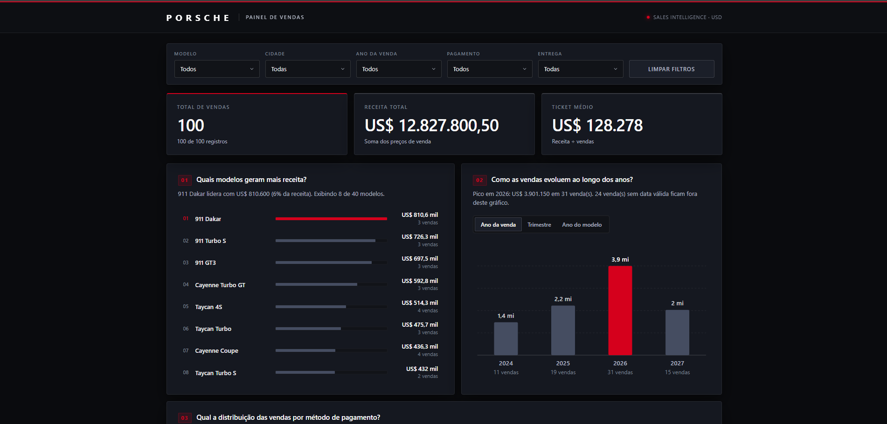
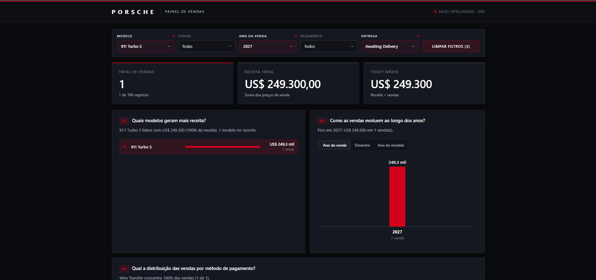

# Dashboard de Vendas Porsche Sales Intelligence

🔗 **[Acessar a Dashboard Publicada](https://Cardasz.github.io/dio-desafios/Formação%20Análise%20de%20Dados%20com%20Excel%20e%20IA/Dashboard%20da%20Porsche%20com%20Agentes%20de%20IA/Dashboard_Porsche_IA.html)**

## Descrição do Projeto
Dashboard de vendas, com foco na organização e visualização de dados. O objetivo é transformar dados brutos em informações visuais claras e úteis, permitindo uma análise eficaz do desempenho de vendas e a tomada de decisões baseadas em dados em uma interface Dark Mode premium inspirada na identidade da marca. (Desafio concluído da Formação em Análise de Dados com Excel e IA da **DIO**).

Este painel foi desenvolvido para responder a **três perguntas de negócio essenciais**:
1. **Quais modelos geram mais receita?** Identificar o "carro-chefe" financeiro ajuda a direcionar campanhas de marketing de alto valor.
2. **Como as vendas evoluem ao longo dos anos?** Entender a sazonalidade permite prever faturamento e planejar estoques.
3. **Qual a distribuição das vendas por método de pagamento?** Revela o perfil de liquidez das transações e guia potenciais parcerias de crédito.

## Estrutura e Funcionalidades
A aplicação foi estruturada de forma altamente otimizada, sem dependência de banco de dados externo ou servidor, concentrando a solução em um único arquivo:
- **D̳ashboard_Porsche_IA.html:** Interface visual que agrega a estrutura da página, o motor de estilização CSS avançado e a lógica de negócios em JavaScript, além de conter a base de dados JSON embutida.

**Principais Funcionalidades:**
- **Filtros Interativos:** Segmentação cruzada (Cross-filtering) por Modelo, Cidade, Ano da Venda, Método de Pagamento e Status de Entrega.
- **Indicadores de Desempenho (KPIs):** Monitoramento em tempo real de *Total de Vendas*, *Receita Total* e *Ticket Médio*.
- **Gráficos e Interatividade:** Análise temporal e de ranking utilizando gráficos gerados 100% em SVG nativo, com tooltips flutuantes de telemetria.
- **Tratamento de Dados de Alta Qualidade:** Os dados originais foram rigorosamente sanitizados antes de ir para a visualização. Datas impossíveis (ex: `2024-02-30`) foram tratadas para não quebrar a lógica, valores financeiros foram limpos e nenhuma informação sensível de cliente (Data Masking) foi incluída no código final.

## Recursos Utilizados
- **HTML5 e CSS3** (Flexbox, Grid, Variáveis Nativas e arquitetura em camadas para Dark Theme)
- **JavaScript (Vanilla)** para manipulação do DOM e lógica de agregações matemáticas
- Renderização gráfica baseada em **SVG Escalonável** (Zero dependências externas como Chart.js)
- **IA e Engenharia de Prompts** (Uso de agente IA como parceiro de Pair Programming)

## Processo de Criação e Prompts
Para desenvolver a lógica e refinar a interface premium, utilizei um **Agente de IA (Gemini)** com instruções direcionadas de programação e design. Abaixo, a evolução dos prompts até a versão final:

* **Prompt de Estruturação Lógica:**
  > "Atue como um Desenvolvedor Front-end e Especialista em Data Visualization. Crie um painel de vendas interativo em um único arquivo Dashboard_Porsche_IA.html usando Vanilla JS, injetando os dados de vendas sanitizados. Inclua 5 dropdowns de filtro e 3 gráficos (barras e série temporal SVG) para responder às perguntas de negócio. Garanta que registros sem data válida continuem no cálculo de receita total."

* **Prompt de Evolução Visual (UI/UX Premium):**
  > "Atue como um Senior UX/UI Designer. Refatore o arquivo Dashboard_Porsche_IA.html no local. Não construa um novo dashboard do zero. Transforme a interface atual em um dashboard premium em Dark Mode inspirado na identidade da Porsche: fundos grafite profundo, tipografia refinada e vermelho Porsche (#D5001C) como acento contido. Preserve 100% das regras de negócio, dados embutidos, cálculos e tratamento da qualidade de dados originais. Melhore a acessibilidade e crie tooltips flutuantes de alta precisão."

## Demonstração Visual



## Estrutura de Arquivos
```text
📦 dio-desafios
 ┣ 📂 Formação Análise de Dados com Excel e IA
 ┃ ┣ 📂 Dashboard da Porsche com Agentes de IA
 ┃ ┃ ┣ 📂 images
 ┃ ┃ ┃ ┣ 🖼️ dashboard-completa.png
 ┃ ┃ ┃ ┗ 🖼️ filtro-aplicado.png
 ┃ ┃ ┣ 📜 base_dados_porsche.xlsx
 ┃ ┃ ┣ 📜 Dashboard_Porsche_IA.html
 ┃ ┃ ┗ 📜 README.md