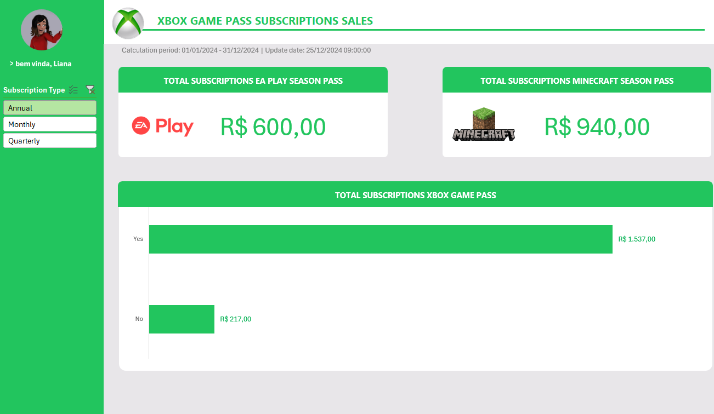
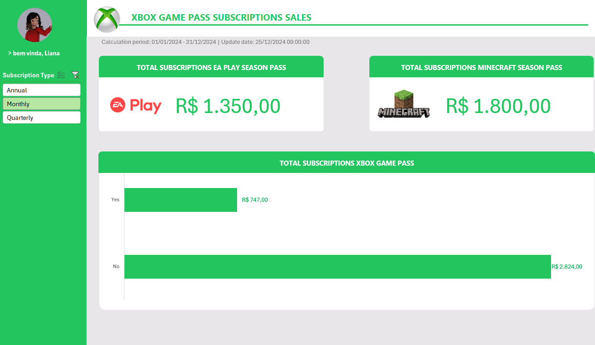
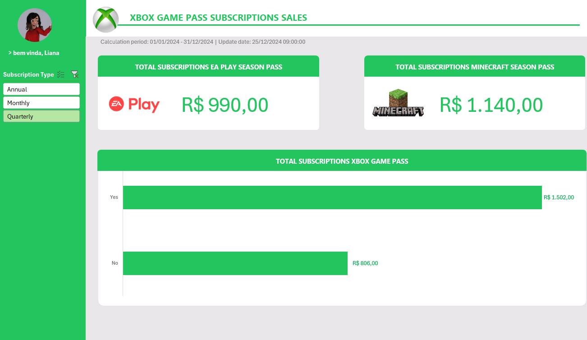

# Dashboard de Vendas do Xbox com Excel

## 📊 Descrição do Projeto
Dashboard de vendas, com foco na organização e visualização de dados. O objetivo é transformar dados brutos em informações visuais claras e úteis, permitindo uma análise eficaz do desempenho de vendas e a tomada de decisões baseadas em dados. (Desafio concluído da Formação em Análise de Dados com Excel e IA da **DIO**).

## 🛠️ Estrutura e Funcionalidades
A planilha foi estruturada de forma profissional e dividida nas seguintes abas:
- **D̳ashboard:** Interface visual com o painel interativo.
- **C̳álculos:** Área dedicada ao processamento dos dados e tabelas dinâmicas.
- **Bases:** Fonte de dados brutos que alimentam o relatório.
- **A̳ssets:** Armazenamento de elementos visuais, ícones e imagens.

**Principais Funcionalidades:**
- **Filtros Interativos:** Segmentação de dados (Slicer) por "Subscription Type" (Annual, Monthly, Quarterly).
- **Indicadores de Desempenho (KPIs):** Monitoramento de faturamento para *EA Play Season Pass* e *Minecraft Season Pass*.
- **Gráficos:** Análise comparativa (Yes/No) para assinaturas do *Xbox Game Pass*.
- **Interface UI:** Design limpo com menu de navegação lateral personalizado.

## 🚀 Recursos Utilizados
- **Microsoft Excel**
- Tabelas Dinâmicas (Pivot Tables) e Gráficos Dinâmicos
- Segmentação de Dados (Slicers)
- Design de interface (UI) voltado para visualização de dados

## 📸 Demonstração Visual




## 📁 Estrutura de Arquivos
```text
📦 Dashboard de Vendas do Xbox com Excel
 ┣ 📂 images
 ┃ ┣ 🖼️ Annual.png
 ┃ ┣ 🖼️ Monthly.png
 ┃ ┗ 🖼️ Quarterly.png
 ┣ 📜 Dashboard de Vendas do Xbox com Excel.xlsx
 ┗ 📜 README.md